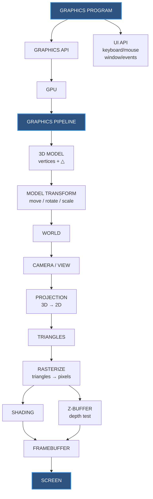

# PETER SHIRLEY - FUNDAMENTALS OF GRAPHICS 

## 1.3 | 1.4 

### Some needed points

- API - A bunch of functions you call to do an operation 
- Graphics API - Functions for telling the computer what to draw 
- UI API - Fucntions for keyboard/mouse/window interaction 
- Graphics Pipeline - The machinery that turns 3D objects into pixels 
- Z - Buffer - Keeps track of what's in front 
- 4D Homogenous coordinates - A mathematical trick that makes 3D transformations easier 
- LOD (Level of Detail)- Use fewer triangles when objects are far away 
- Framebuffer - Basically it is the image that is currently being built. It it is the storage containing the pixel data for the image that has to be rendered. 

### The Summary  


## 1.5 

## The Summary 

- Graphics involves huge amounts of numerical computation 
- Floating-point arithmetic follows IEEE 754 
- There are special values - +∞ | −∞ | NaN 
- For any positive number "a", the rules involving division by INFINITY hold - 
```txt
+a / (+∞) = +0
−a / (+∞) = −0
+a / (−∞) = −0
−a / (−∞) = +0 
``` 

- Some other operations - 
```txt 
∞ + ∞ = +∞
∞ − ∞ = NaN
∞ × ∞ = ∞
∞ / ∞ = NaN
∞ / a = ∞
∞ / 0 = ∞
0 / 0 = NaN 
``` 

- Rules related to NaN - 
1. Any arithmetic expression that includes NaN results in NaN.
2. Any Boolean expression involving NaN is false. 
